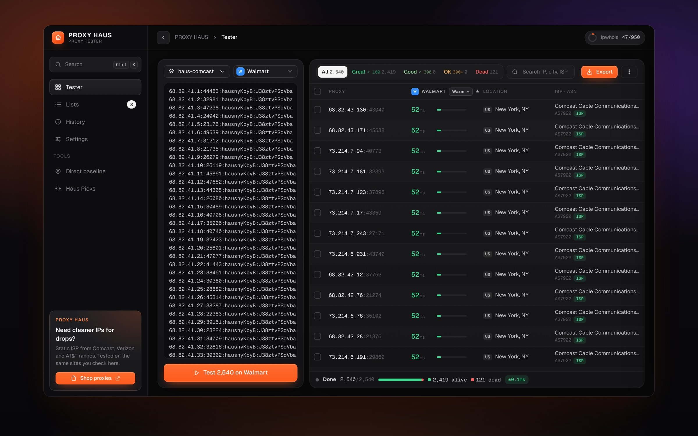
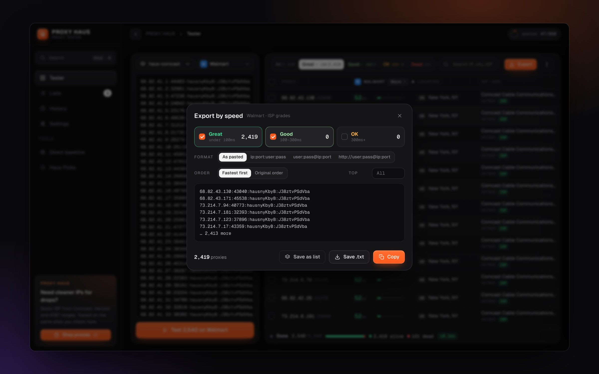
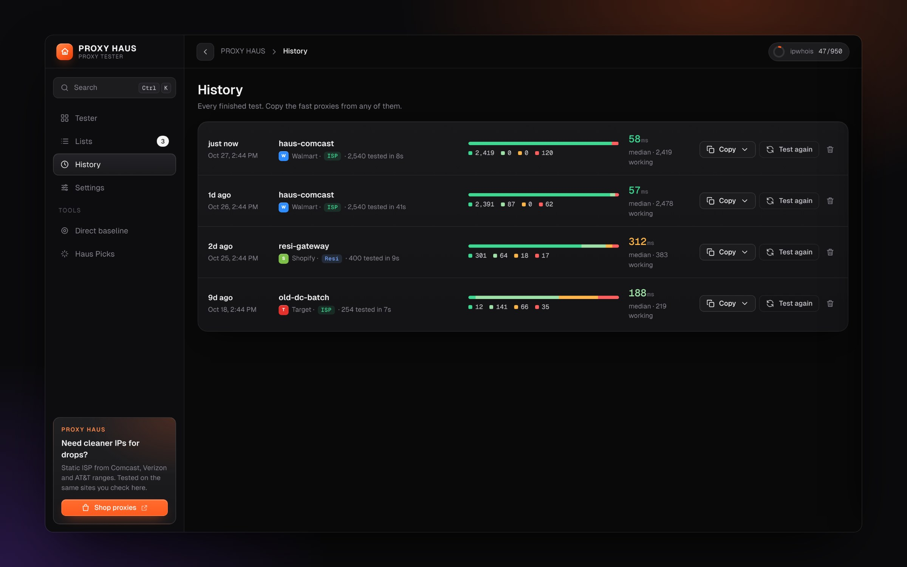

# PROXY HAUS Tester

**Fast, accurate proxy testing for ISP and residential lists. Test thousands at once, right from your own computer.**

[Download](#download) · [Features](#features) · [Getting started](#getting-started) · [Speed grades](#speed-grades) · [FAQ](#faq)

 

 

## Download

&nbsp;&nbsp;

Always the newest version · [All releases](https://github.com/mxnnxt/proxy-haus-tester-releases/releases)

 

## Features

- **Real ms, from your machine.** Every test runs locally through each proxy to the site you pick, so the numbers match what your tasks see.
- **Built for big lists.** Thousands of proxies per run, with results animating in as they land. Gateway lists are paced so the gateway doesn't inflate your numbers.
- **Test against the sites you run.** Google, Shopify (any store domain), Walmart, Pokémon Center, Target, Amazon, Best Buy, GameStop, or add your own.
- **ISP or resi, detected automatically.** Speed grades adjust to the list type.
- **Location and ISP for every proxy.** City, region, ISP, ASN, and whether the IP is ISP, mobile or datacenter.
- **Export by speed.** Copy or save only the Great and Good proxies, fastest first, in the format your bot wants.
- **Lists and history.** Save lists, retest in one click, and copy the fast ones from any past test.

## Getting started

1. **Install.** Download above and run the installer.
2. **Paste your proxies.** Any common format works: `ip:port:user:pass`, `user:pass@host:port`, `http://…`, `socks5://…`
3. **Pick a site** from the dropdown next to your list.
4. **Hit Test.** Then filter by Great / Good / OK and hit **Export**.

## Speed grades

| List type | Great | Good | OK |
|---|---|---|---|
| **ISP** (static IPs) | under 100 ms | 100–300 ms | 300 ms+ |
| **Resi** (gateways / rotating) | under 500 ms | 500–1000 ms | 1000 ms+ |

The ms column can show three measurements:

- **Warm** (default): a request on an already-open connection, which is what a running task feels.
- **Tunnel**: network only, through the proxy to the site.
- **Cold**: a brand-new connection, start to finish.

## FAQ

<b>Windows says "Windows protected your PC"</b>

 
Click <b>More info → Run anyway</b>. This shows for new apps until enough people have downloaded them.

<b>macOS says the app can't be opened</b>

 
Right-click the app → <b>Open</b> → <b>Open</b>. Or go to <b>System Settings → Privacy &amp; Security</b> and click <b>Open Anyway</b>.

<b>Where are my lists stored?</b>

 
On your computer only. Nothing is uploaded. Location data comes from ipwhois.io, which only receives the proxy IP address.

<b>How do I update?</b>

 
Download again from this page and run the installer. Your lists and history are kept.

 

**Need faster, cleaner proxies?** → [proxy-haus.com](https://proxy-haus.com)

© PROXY HAUS. All rights reserved. This repository only hosts installers.

